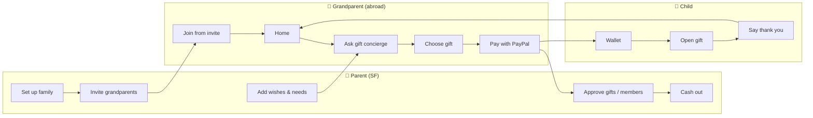
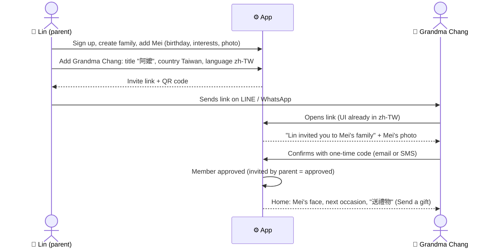
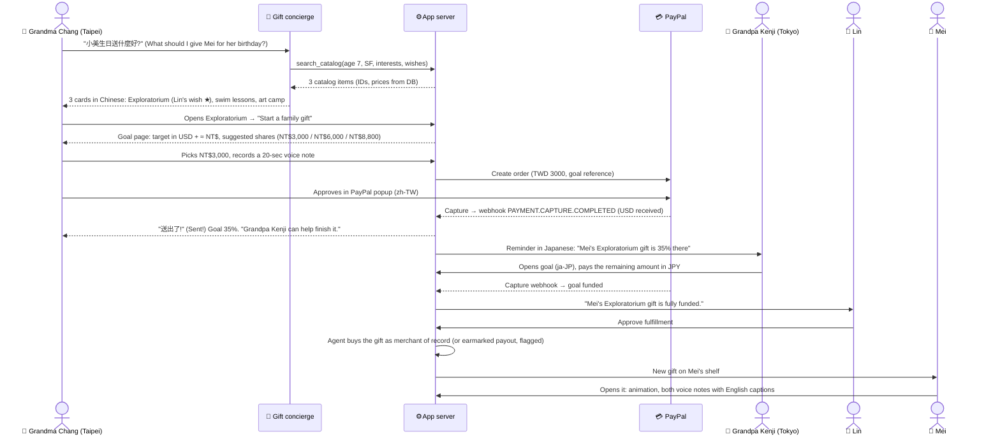
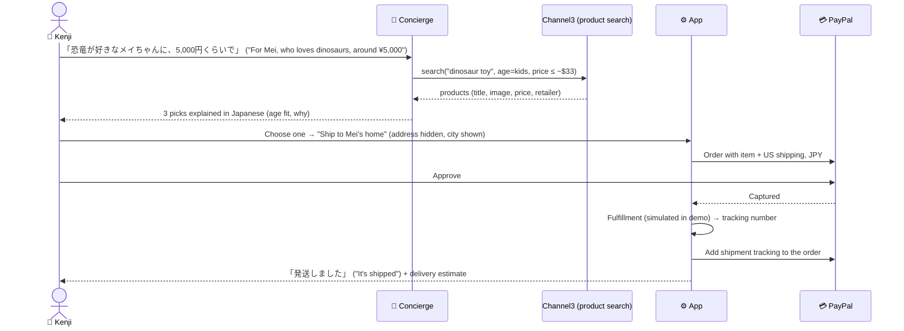
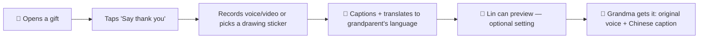
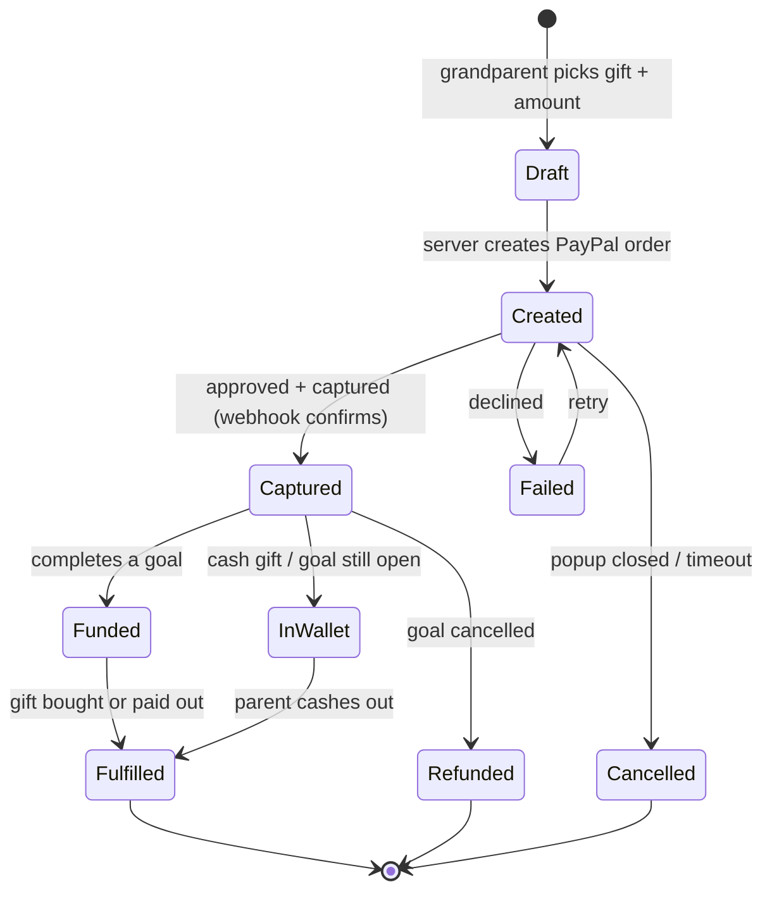

# User Flows

*v1 · Nov 5, 2026 · Companion docs: [DESIGN-BRIEF.md](DESIGN-BRIEF.md) · [TECH-SPEC.md](TECH-SPEC.md)*

> **MVP update (v2):** the hero gift is now **"Saturday at the movies"** ($100 Regal card) pooled by Grandma Chang (TWD) and Grandpa Kenji (JPY). Flow A's steps are the same, and the Exploratorium becomes the second gift. The parent's role is three taps ("we have this" · "yes, this month" · "pick a Saturday"), and a photo comes back after the outing. Flows C (items), D (allowance) and G's payout are cut from the MVP. See MVP-STORY.md.

**Demo cast**
- **Lin** (parent, San Francisco)
- **Mei**, Lin's 6-year-old
- **阿嬤 (Grandma) Chang** in Taipei, zh-TW, pays in TWD
- **おじいちゃん (Grandpa) Kenji** in Tokyo, ja-JP, pays in JPY
- **Mamie Claire** in Paris, fr-FR, pays in EUR

**Legend:** 👵 grandparent · 👩 parent · 👧 child · 🤖 AI · 💳 PayPal · ⚙️ server

---

## Flow map



---

## Flow 0: Setup (parent creates the family, grandparent joins)

**Goal:** a grandparent gets in with one link and no English, and the parent controls who can give.



| Screen | What's on it | States |
|---|---|---|
| P-Setup 1: Family | Family name, city (SF prefilled) | Validation: name required |
| P-Setup 2: Child | Name, birthday, photo, 3–5 interests (chips: dinosaurs, swimming, drawing…) | Photo optional; placeholder initial |
| P-Setup 3: Invite | Grandparent title, country, language, and how they'll get the link | Language auto-suggested from country |
| G-Join | Mei's photo, "Lin invited you", one code input, big confirm button | Wrong or expired code: "Ask Lin for a new link" |

**Rules**
- Only people the parent invites can join. Anyone added later needs parent approval (see Flow 7).
- The invite link carries the language, so the grandparent never sees an English screen.

---

## Flow A (hero): Gift goal, pooled across countries

**Story:** Mei turns 7 in 3 weeks. Lin added "Exploratorium family membership" as a wish. Grandma Chang and Grandpa Kenji fund it together.



**Screens and states**

| # | Screen | Key content | Empty / loading / error |
|---|---|---|---|
| A1 | Grandparent home | Mei's photo, "生日還有 21 天" (21 days until her birthday), one button "送禮物" | No wishes yet: still offers concierge and red envelope |
| A2 | Concierge | Chat + hold-to-talk, 3 starter prompts | Thinking: "正在想小美會喜歡什麼…" ("Thinking about what Mei would like…"). AI fails: show Lin's wish list instead |
| A3 | Suggestion cards (max 3) | Illustration, title in Chinese, one-line why ("適合7歲、喜歡科學的孩子", "for a 7-year-old who loves science"), price ≈ NT$, "★ Lin's wish" tag | n/a |
| A4 | Gift detail | What it is (in Chinese), what it covers ("一整年,全家可以無限次參觀", "a full year, unlimited family visits"), goal bar, who has given | Goal already funded: "Already covered by family 🎉. Choose another?" |
| A5 | Contribute | Suggested amounts (lucky numbers), custom amount, **cover-fees toggle (on)**, **cost receipt estimate** (you pay · PayPal fees · conversion · family receives · total %), *"You pay in NT$, so PayPal won't add a conversion fee on your side"*, message/voice note, the PayPal button, *"This goes to Mei's family, approved by Lin"* with Mei's photo | Amount too low (under the minimum): inline note. Over the remaining: "Only NT$X is still needed". Quote expired (10 min): receipt refreshes with "Rate updated" |
| A6 | PayPal popup | PayPal's own UI in zh-TW | Cancel → back to A5 with everything saved. Decline → "PayPal couldn't take this payment…" + retry |
| A7 | Sent | "送出了!小美明天早上會看到" ("Sent! Mei will see it tomorrow morning"), goal bar animates, **final receipt with PayPal's actual fee and rate** ("Estimated $85.97 · Actual $86.10") | Webhook slow: "PayPal is confirming. This usually takes a few seconds." Receipt shows the estimate until confirmed |
| A8 | Parent approval | Gift, givers, **full receipt per contribution** (paid in local currency, PayPal fees, conversion, received USD), **payout fee and what lands in Lin's account**, payout destination | Payout fails: reason + retry / change account |
| A9 | Child gift opened | Illustration fills, faces of givers, play buttons, "Say thank you" | Voice note fails to load: show caption text |

**Business rules**
- **Every money moment shows PayPal and the cost.** The receipt appears at A5 (estimate), A7 (actual) and A8 (parent + payout). The PayPal popup total must equal the receipt's "You pay" exactly.
- **Amount suggestions** come from the custom rules engine (TECH-SPEC §6): even amounts, include 6 or 8, no 4.
- **Remaining amount cap:** a contribution can't exceed what's still needed (plus a small buffer for rate changes). Any overage stays in Mei's wallet as cash.
- **Fulfillment:** the primary path is that Thought buys the gift as merchant of record (the AI agent orders the Exploratorium "any amount" gift or a gift card via PayPal's MCP commerce tools, or a simulated order). The demo can also show the **earmarked payout** to the parent, flagged in the video as needing PayPal approval in production (see [PAYPAL-FEASIBILITY.md](PAYPAL-FEASIBILITY.md) #11).
- **Deadline:** a goal can have an occasion date. If it isn't funded by then, the parent chooses: (1) pay out what's there, marked for the gift, or (2) refund everyone (Flow 8).

---

## Flow B: Red envelope (cash moment)

**Story:** Lunar New Year. Grandma Chang sends Mei a 紅包.

```mermaid
flowchart TD
  B1[Home: "新年快樂" banner in Jan/Feb] --> B2["Choose: 紅包 (red envelope)"]
  B2 --> B3["🤖 Suggests amounts: NT$600 · NT$1,200 · NT$2,000 with a one-line reason"]
  B3 --> B4{Amount picked}
  B4 -->|Contains a 4, e.g. NT$1,400| B5["Gentle note: '4 sounds like death (死) in Chinese. Try NT$1,600 or NT$1,200?' (can still continue)"]
  B4 -->|OK| B6[Write a blessing or record a voice note]
  B5 --> B6
  B6 --> B7[💳 Pay in TWD]
  B7 --> B8[Sent: 'Mei will open it on New Year's morning']
  B8 --> B9["👧 Mei: animated envelope; taps to open; amount + voice note"]
  B9 --> B10[Money lands in Mei's wallet as cash]
```

- **Japanese version (お年玉):** amount suggestions by age (≈¥1,000 for preschool, ¥2,000–3,000 for elementary school, ¥5,000+ for teens). Envelope style is a ぽち袋 (*pochi-bukuro*, a small gift envelope), not red.
- **Scheduling:** the grandparent can send early; the envelope "unlocks" on the occasion date in Mei's time zone.
- **AI blessings:** the AI can suggest a blessing in the grandparent's language (for example 「新年快樂,平安長大」, "Happy New Year, grow up safe and well"). The grandparent edits or keeps it; Mei sees it with an English translation underneath.

---

## Flow C: Buy an item (shipped to SF)

**Story:** Grandpa Kenji wants to send a dinosaur toy, budget ¥5,000.



- **Privacy:** the grandparent never sees the family's full street address, only "San Francisco."
- **Parent setting:** "Ask me before items ship" is on by default (avoids duplicate toys or unwanted items).
- **Cut first** if time is short.

---

## Flow D: Monthly allowance (subscription)

1. Mamie Claire (fr-FR) → "Un petit cadeau chaque mois" ("A small gift every month")
2. 🤖 suggests €10/€20/€30, plus a choice of "argent de poche" (pocket money) or "un livre par mois" (a book a month)
3. 💳 PayPal subscription approval (each month shows its own cost receipt)
4. Each month: a webhook adds to Mei's wallet, and Mei sees "Mamie sent your May gift"
5. Mamie can pause or cancel from her home screen in one tap. Lin is notified.

---

## Flow E: Care credit (help the parents)

**Story:** Lin just had a second baby. Grandma Chang wants to help, not just with toys.

1. The concierge suggests a "for the family" category: DoorDash dinners, babysitter evenings, or diapers & wipes for a month
2. Grandma Chang picks "3 babysitter evenings" (price set by Lin's local rate in her profile)
3. 💳 Pay → Lin is notified: "阿嬤 sent you 3 sitter evenings 💛"
4. Payout to Lin, earmarked "Babysitting from 阿嬤". In the demo this is an earmarked payout; partner gift cards come later.
5. Lin taps "Say thanks" and sends a photo of date night back to Grandma.

---

## Flow F: Child says thank you



- The original voice is always kept; translation is an extra layer.
- For kids under 6 the thank-you is mostly voice or a drawing; no typing.

---

## Flow G: Parent approves and cashes out

| Step | Screen | Notes |
|---|---|---|
| G1 | Parent home | Inbox of new gifts, goals funded, members waiting |
| G2 | Gift detail | Who, what, amount in their currency and USD received, message |
| G3 | Approve payout | Destination: Lin's PayPal email or Venmo; note prefilled with the gift |
| G4 | Payout status | Pending → Sent (webhook), or Failed with reason |

**Settings:** auto-approve cash gifts under $X; always ask for items; show dollar amounts to Mei (on/off).

---

## Flow H: Scam guard

**Scenario A: inside the app.** A message in chat says "Send the money to this new account instead."
1. 🤖 detects a request to pay someone outside the family.
2. Response in the grandparent's language: "I can only send gifts to Mei's family. Lin approves everyone. If someone asked you to pay elsewhere, please call Lin first."
3. Nothing can actually be paid to an outside account: the server only creates orders for approved members of this family.

**Scenario B: a new "relative" asks to join.**
1. Someone asks to join the family.
2. Lin must approve before they can give or see anything.
3. Grandparents never see a "pay this person" field anywhere in the app.

---

## Flow I: Goal cancelled → refunds

1. Lin cancels a goal (for example, Mei already has a membership).
2. The server issues PayPal refunds for each captured contribution (in the original payment). PayPal keeps its original fee, so **Thought absorbs it** and each grandparent gets back exactly what they paid. Lin sees the absorbed fee before confirming.
3. Each grandparent sees in their language: "Lin changed the plan. Your NT$3,000 is on its way back to your PayPal."
4. Alternative offered first: "Move the money to Mei's wallet or another wish instead."

---

## Money state machine (one contribution)



---

## 3-minute demo script (maps to flows)

| Time | Flow | On screen |
|---|---|---|
| 0:00–0:25 | Story | Photo-style intro: a grandma visiting SF, English apps she can't read |
| 0:25–1:20 | A (part 1) | Grandma Chang asks in Chinese → 3 gifts → pays NT$3,000 in the zh-TW PayPal popup |
| 1:20–1:45 | A (part 2) | Grandpa Kenji finishes the goal in Japanese → goal funded |
| 1:45–2:10 | G + A9 | Lin approves → the agent buys the gift → Mei opens it and hears both voices with English captions |
| 2:10–2:30 | B or H | Quick red envelope with a lucky-number nudge, or the scam guard refusing |
| 2:30–2:50 | Proof | The cost receipt, estimate vs actual, next to the PayPal sandbox dashboard: orders, captures in TWD/JPY with fee + exchange rate, payout |
| 2:50–3:00 | Close | "Xoom sends money. Thought sends love." + the impact numbers |
